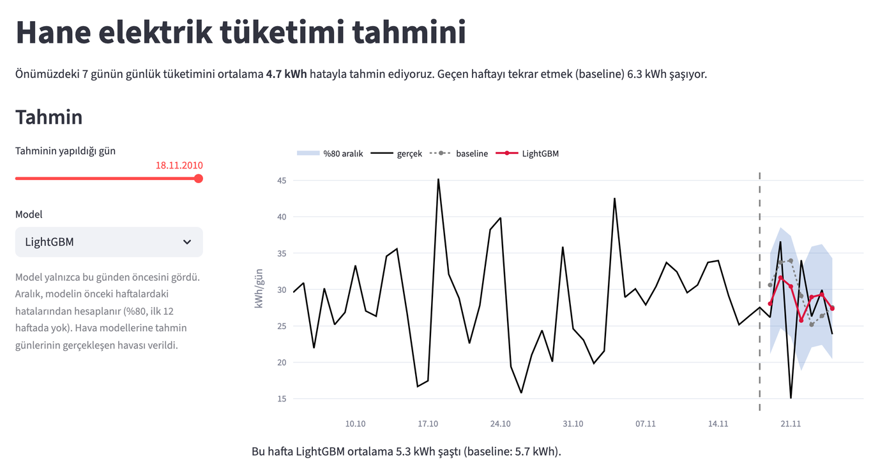
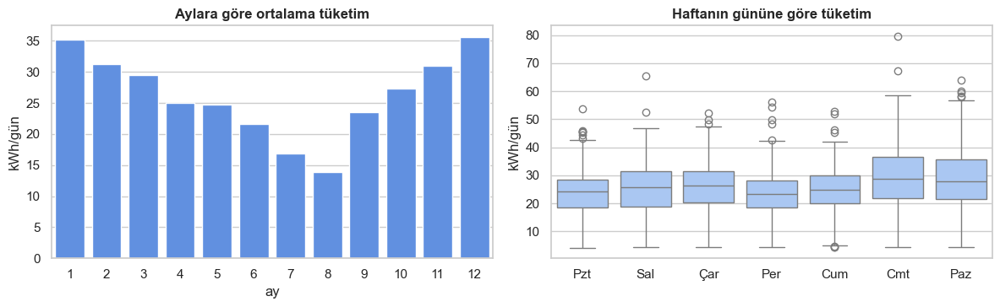

# Household power forecast

Seven models forecast one French household's daily electricity use 7 days ahead, compared on a 52-week rolling backtest. Data: [UCI Individual Household Electric Power Consumption](https://archive.ics.uci.edu/dataset/235), one reading per minute, 2006–2010.

Live demo: https://household-power-forecast.streamlit.app (Turkish UI)



## Results

Every week each model is refit on the data up to that day and forecasts the next 7. The baseline, Seasonal naive, repeats the previous week. Error is mean absolute error in kWh per day; average use is 26 kWh per day.

| model | MAE | vs baseline |
|---|---|---|
| LightGBM | 4.66 | −26% |
| LightGBM + weather | 4.67 | −26% |
| Prophet + weather | 4.67 | −26% |
| Prophet | 4.68 | −25% |
| SARIMA | 4.81 | −23% |
| SARIMAX + weather | 4.87 | −23% |
| Seasonal naive | 6.28 | 0 |

Every model beats the baseline by about 1.5 kWh a day, and none is clearly better than the others.

- All six beat the baseline by 1.4–1.6 kWh a day (paired Wilcoxon test, Holm-corrected p < 0.001).
- The 95% intervals of the differences between models span about ±0.35 kWh on average, so the ranking above is not reliable.
- Weather did not help: none of the 3 pairs with and without weather is significant. Adding noise to the weather made SARIMAX and LightGBM worse.
- The 80% prediction interval covers 80–86% of actual values and is about 15 kWh wide. It covers weekends worse: about 73%, against 87% on weekdays.



## Files

| file | what it does |
|---|---|
| `data.py` | Minute data to daily kWh, plus Open-Meteo weather. |
| `models.py` | The seven models behind one `fn(y, h, x, **params)` interface. |
| `tune.py` | Grid search on the 4 weeks before the backtest window. |
| `backtest.py` | 52 weekly forecasts, each model refit every time. |
| `evaluate.py` | Metrics, 80% intervals, paired tests, error breakdowns. |
| `sensitivity.py` | Re-runs the weather models with noise added to the weather. |
| `report.py` | Prints the tables behind the numbers above. |
| `notebooks/eda.ipynb` | Exploratory analysis, in Turkish. |

## Run

Python 3.12 or 3.13.

```bash
pip install -r requirements.txt
streamlit run app.py        # reads the committed data/*.csv
```

To rebuild everything, download `household_power_consumption.txt` from the UCI page above into `raw/`, then:

```bash
pip install -r requirements-dev.txt
python data.py              # data/daily.csv
python tune.py              # data/params.json
python backtest.py          # data/backtest.csv, about 15 min
python sensitivity.py       # data/sensitivity.csv, about 12 min
python report.py            # prints the results
pytest
```

`tune.py` and `backtest.py` accept model names to rerun only those, for example `python backtest.py LightGBM`.

## Limits

- One household, one test year.
- 9 days have no readings at all and are interpolated.
- Forecasts are made on Thursdays, so every one starts on a Friday and days ahead cannot be told apart from weekday.
- The weather models are given the observed weather of the forecast days. Real forecasts are worse; `sensitivity.py` simulates that.
- Hyperparameters were tuned on only 4 weeks.
- The interval is symmetric, and the first 12 weeks have none.
